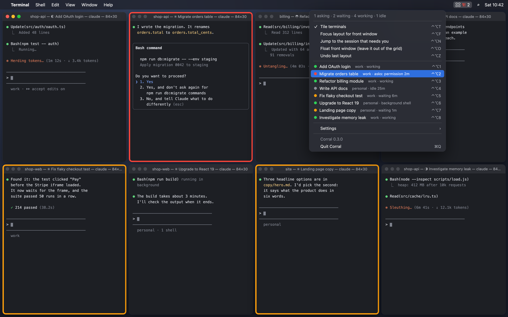

# Corral

A macOS menu-bar app for people who run many [Claude Code](https://claude.com/claude-code)
sessions at once in Terminal.app. It tiles every Terminal window into a grid,
re-tiles when one opens or closes, and shows at a glance which sessions are
asking you something and which have finished.



*Illustration of the layout and frames; the session names are made up.*

> **Unofficial.** Corral is not made by or affiliated with Anthropic. It reads
> files and window titles that Claude Code writes for its own use (see
> [How it works](#how-it-works)). They are not a public API, so a Claude Code
> update can change them and break the session states until Corral catches up.
> Tiling keeps working either way.

## What it does

- **Tile** (`⌃⌥T`): every visible Terminal window goes into a grid on the
  chosen displays. Rows with fewer windows get wider cells, so there are no
  empty slots (10 windows on 1920x1080 = rows of 4, 3, 3). With two displays
  the windows are split in proportion to display area.
- **Auto-tile**: a new window, a closed one, a minimise or un-minimise, a
  Space change or a display change re-tiles after half a second. Windows keep
  their slots; a window never tiled before goes last. Windows already in
  their slot are not touched (every resize makes Claude redraw its screen).
- **Drag to swap**: drag a tiled window by its title bar onto another window's
  slot and let go: the two swap places. Drop it on a display Corral does not
  tile onto and it floats there. A small nudge snaps back. Resizing from an
  edge is not a drag.
- **Focus layout** (`⌃⌥F`): the front window gets 60% of its display and the
  rest share the column beside it. Press again to go back to the grid.
- **Sessions that need you**:
  - *Asking* (red frame, red `2!` in the menu bar): blocked on you by a
    permission prompt, a question, an agent request or an open dialog. A
    `claude` that has written no status 10 s after launch is stuck at a
    startup prompt (trust this folder, login) and counts too.
  - *Waiting* (orange frame, plain count): finished its turn after the last
    time you had its window in front.
  - `⌃⌥N` jumps to whoever has been asking longest, then to whoever has
    waited longest.
- **Session menu** (`⌃⌥S` or click the icon): every session with its account
  (when you run several Claude Code config dirs), its state (asks: permission
  3m, waiting 12m, working, background shell, idle) and its slot shortcut.
  Type the first letters of a name to jump to it.
- **Slots** (`⌃⌥1` to `⌃⌥9`): focus the Nth window in grid order, top-left first.
- **Float** (`⌃⌥O`): leave the front window out of the grid. Floating windows,
  the focus layout and which windows you have seen survive a restart of Corral
  (not a relaunch of Terminal: window ids start over then).
- **Undo** (`⌃⌥Z`): put windows back where they were before the last layout.

All shortcuts use Control+Option: Option alone types characters on many
European keyboard layouts, and `⌃⌥Space` belongs to the macOS input-source
switcher.

Settings (menu > Settings): auto-tile on/off, frames on/off, which
displays to tile onto, gap between windows (0/4/8/12 pt), open at login.
The first launch picks the display that already holds the most terminals.

## Install

There is no prebuilt download: Corral is built from source, which takes about
ten seconds.

Needs macOS 13 or later, Terminal.app, and the Xcode Command Line Tools
(`xcode-select --install`, Swift 5.10 or later). Developed on macOS 26 with
Apple silicon; older systems are untested.

```sh
git clone https://github.com/urbanodx/corral.git
cd corral
make cert      # optional, once: see below
make install   # builds, copies to ~/Applications/Corral.app and starts it
```

On first launch macOS asks for two permissions:

- **Accessibility**, to move and raise windows. Turn Corral on in System
  Settings > Privacy & Security > Accessibility.
- **Automation > Terminal**, to read window titles and ttys. Click Allow.

**About `make cert`.** macOS ties the Accessibility permission to the app's
code signature. Without a signing identity every build is signed ad hoc, gets
a new signature, and macOS drops the permission on each rebuild. `make cert`
creates a self-signed code-signing certificate called "Corral Local Signing"
in your login keychain (valid for ten years, usable only for code signing) so
rebuilds keep the permission. Skip it if you only build once. Remove it with
`security delete-identity -c "Corral Local Signing"`.

Other commands:

```sh
make test        # layout, title, status-file and session tests
make universal   # one binary for Apple silicon and Intel
make uninstall   # removes the app, its login item and its settings
~/Applications/Corral.app/Contents/MacOS/Corral --print   # dry run: what it sees, where it would tile
```

## How it works

| Need | Source | Why |
|---|---|---|
| Titles, ttys, minimised, window ids | Terminal AppleScript, one batched call per second | Accessibility has no tty |
| Session state and folder | `<config dir>/sessions/<pid>.json`, written by Claude Code | the most direct signal there is |
| Which config dir (account) a session uses | `CLAUDE_CONFIG_DIR` in that process's environment (`ps eww`), else `~/.claude` | one dir per account when you run several |
| Which pid runs on which tty | `ps -A -o pid=,etime=,tty=,comm=` every 3 s, off the main thread | status files have no tty |
| True window frames | `CGWindowListCopyWindowInfo` | no permission, always right |
| Moving and raising | Accessibility (`AXPosition`, `AXSize`, `AXRaise`) | see the first trap below |
| End of a window drag | a global left-mouse-up monitor (needs Accessibility) | no polling |
| Shortcuts | Carbon `RegisterEventHotKey` | no Input Monitoring permission |

Claude Code (checked with 2.1.296) keeps a JSON file per running session with
`status` set to `busy`, `shell` (the turn ended with a background shell still
running; Claude resumes by itself), `idle` or `waiting`, and while waiting a
`waitingFor` such as `permission prompt` or `input needed`. Corral follows the
rule Claude's own `claude agents --json` uses: idle is idle, waiting is
waiting, anything else is busy. When there is no status file (older versions,
Claude over ssh), the window title decides: Claude puts `✳` before the session
name when idle and a spinner (`◐◓◑◒`) while working. A title that still shows
`✳` with the shell back in front belongs to a session that ended.

**Trap:** Terminal's AppleScript `bounds` and `position` *setters* are wrong
on a secondary display. They read y relative to the window's current display
and offset it by that display's top edge (186 pt on one test setup), so a
window lands lower than asked and can end up half off-screen. The `bounds`
*getter* is right. Corral never uses the setters.

**Trap:** Terminal rounds a window's size to whole character cells, to the
*nearest* cell, so a window can come out up to half a cell bigger than its
slot and overlap the next one (478 pt wide in a 475 pt slot). After each tile
Corral checks the real sizes and asks once more for less (slot minus twice the
overflow), which lands one cell smaller; the size that worked is remembered
per slot size.

**Trap:** a secondary display can report a `visibleFrame` that still includes
its menu bar. Corral removes the menu-bar height when `visibleFrame` starts
at the very top of the display.

It uses one private but long-stable function, `_AXUIElementGetWindow`, to
match Accessibility windows to window ids, as Rectangle, AeroSpace, yabai and
Hammerspoon do.

Code: `Sources/Layout.swift` is pure math (tested), `TerminalBridge.swift`
reads Terminal, `WindowMover.swift` moves windows, `ClaudeMonitor.swift` reads
Claude's status files and `ps`, `Sessions.swift` turns all that into sessions
and tracks who needs you, `Borders.swift` draws the frames, `App.swift` is the
menu and wiring. `make test` runs every source but `App.swift` against
`Tests/main.swift` (no XCTest needed).

## Limits

- Terminal.app only. iTerm2, Ghostty or the VS Code terminal would each need
  their own bridge.
- Only the selected tab of each window is read.
- No App Store build: it needs Accessibility and Apple Events to another app.

## Why not AeroSpace, Rectangle or yabai

AeroSpace and yabai tile every app, and AeroSpace's default shortcuts are
Option plus a letter, which types characters on many European layouts.
Rectangle and Magnet
snap one window at a time. None of them know which Claude session is working
or waiting, which is the real question with ten sessions open. Corral only
touches Terminal and adds that layer. Ideas taken: AeroSpace's gapless tiling,
Amethyst's main-pane layout, Moom's undo, JankyBorders' window frames.

## License

[MIT](LICENSE)
